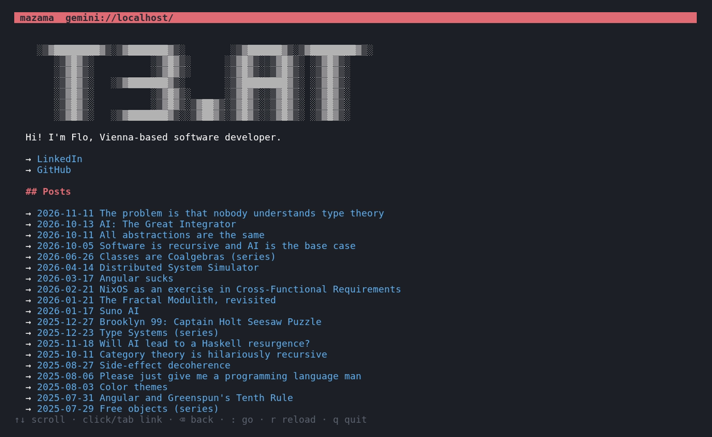
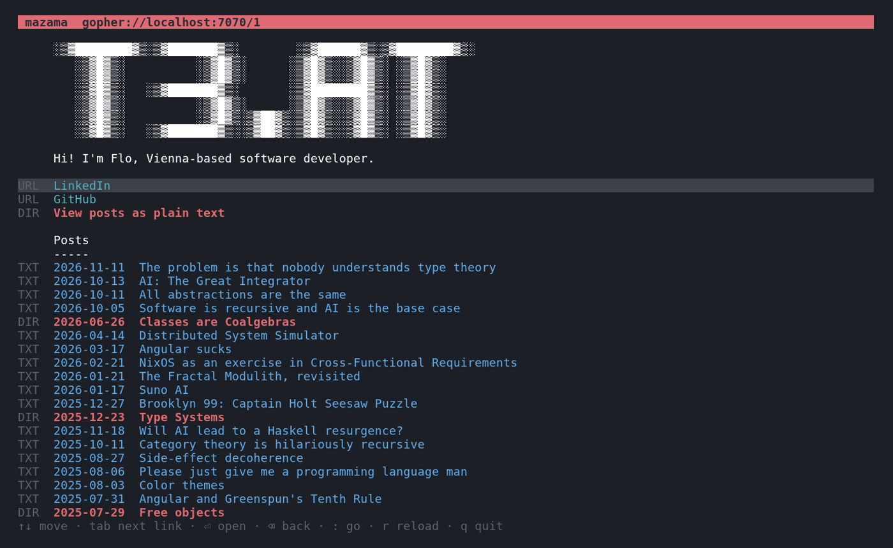

# mazama

A terminal client for the small web: **gopher** and **gemini**, built with
[bubbletea](https://github.com/charmbracelet/bubbletea),
[lipgloss](https://github.com/charmbracelet/lipgloss) and
[glamour](https://github.com/charmbracelet/glamour). I literally vibecoded
this in an hour.

| gemini | gopher |
| --- | --- |
|  |  |

## Run

```sh
nix-shell        # or: direnv allow
go run . [address]
```

`address` can be a `gopher://`, `gemini://` or `https://` URL, or just a host
(`sdf.org`, `example.org/notes/a.gmi`): without a scheme, mazama guesses the
protocol from the address and, if needed, by probing the host. It defaults to
`gopher://gopher.floodgap.com/`.

## Features

- Gopher menus with type tags, search items, and `URL:` links.
- Gemini with trust-on-first-use certificates
  (`~/.local/share/mazama/known_hosts`), input prompts and redirects.
- Gemtext and markdown rendered with glamour. Links show only their text:
  click once to see the URL, again to open it.
- Web links open in your browser via `xdg-open` / `open`.
- Mouse support: wheel, click to follow, back button.
- Themes: `-style one-dark` (default), any glamour style (`dracula`,
  `tokyo-night`, …), `auto`, or a glamour JSON file. Menus follow the theme.

## Keys

| key               | action                             |
| ----------------- | ---------------------------------- |
| ↑↓ / j k          | move / scroll                      |
| ctrl+↑↓           | move / scroll 10 lines             |
| tab / shift+tab   | next / previous link               |
| enter             | open                               |
| backspace         | back                               |
| `:`               | go to address                      |
| r                 | reload                             |
| esc               | cancel / deselect                  |
| q                 | quit                               |
